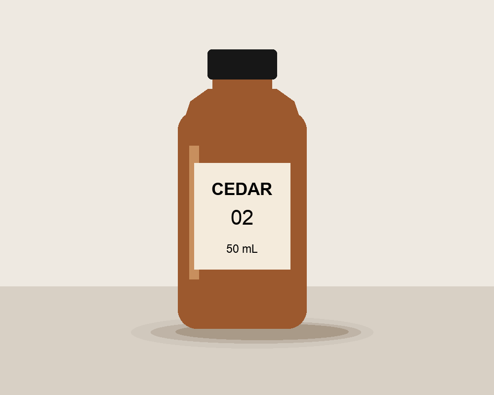
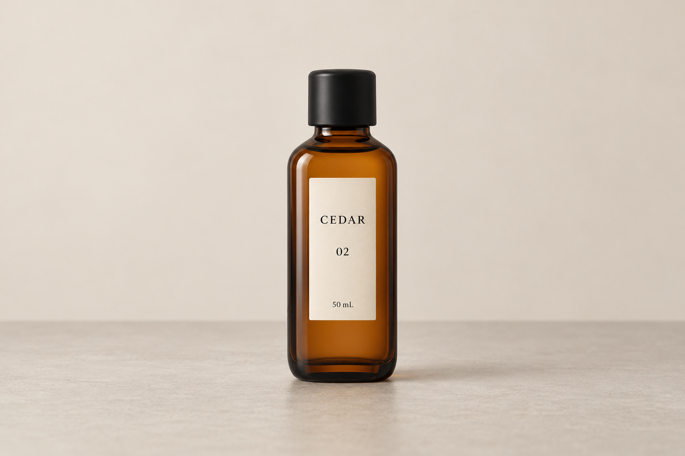
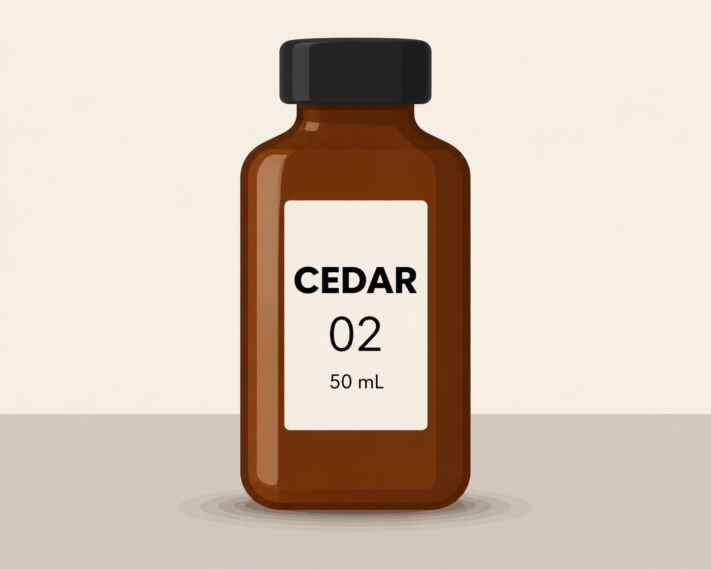

# 5S Skill：真实模型执行与独立 AI 盲评

本轮已完成用户要求的真实模型运行、独立盲评和一组实际出图验证。测试对象为已冻结的 v0.2.0 Skill；v0.2.1 只补充评测工具、证据和文档，未根据本轮答案调优 Skill 指令。

## 结果

| 项目 | 结果 |
| --- | --- |
| 正式视觉模型请求 | 6 个原创场景 × 有/无 Skill，共 12 次，全部成功，无候选工具调用。 |
| 执行模型 | Codex CLI 请求 gpt-6.1-sol，使用现有 OpenAI 登录；CLI 未提供服务端型号证明。 |
| 参考材料 | 7 张原创图片，覆盖文字海报、产品、人物物品关系、双图角色、局部编辑及画内恶意命令。 |
| 独立提示词盲评 | 两位评委均给 Skill 59/60、对照 58/60；各为 1 胜、5 平、0 负。 |
| 实际出图 | 预先指定产品场景，每组用最终提示词生成 1 次，不附参考图、不挑图、不重抽。 |
| 独立出图盲评 | 两位新评委均给 Skill 8/10、对照 5/10。 |

提示词差异主要来自媒介忠实度：对照把原本的平面产品插画写成产品摄影，Skill 保留了几何平涂、字体层级和分层椭圆阴影。其他五项未发现足以区分的实质优势，不能宣称全面提升。

实际出图也有缺陷：Skill 组仍加入了过强的立体渐变、把瓶子画得过大、压缩上下留白；对照组改变了参考媒介、字形与瓶体比例。两组图片的文字均正确，未增加道具。

## 实际出图对比

| 原创参考图 | 无 Skill 的提示词出图 | 使用 Skill 的提示词出图 |
| --- | --- | --- |
|  |  |  |

出图通过内置 image_gen 工具完成。工具不公开确切后端模型 ID、seed 或 token 消耗；两张实际分辨率也不同。因此这证明了提示词到图片的流程可用，不构成已验证的 GPT Image 2.5 API 同参数基准。

## 如何保证公平

1. 独立设计代理在没有读 Skill 或已有答案的情况下先设计任务与五项视觉判据。绘图脚本经另一代码评审代理实际查看图片，修复了一处圆心坐标冲突后冻结。
2. 每组使用相同模型、用户请求和真实附件。实验组只多接收一次读取并冻结的 Skill 正文及参考细则，不额外增加防注入等提示。
3. 两组都关闭已发现的本地技能加载路径，防止对照自动加载同一 Skill。使用只读临时运行目录，不改宿主配置；禁止候选调用工具，观察到的正式输出均无工具调用。
4. A/B 次序随机且两种来源各三次置于 A。两位新上下文代理分别查看相同的参考图片与匿名答案，按五项判据各 0/1/2 打分。不奖励长度、标题或框架名。同分保留为平局。
5. 两份评审完成并保存哈希后才打开身份映射。出图另做随机身份映射，并交给另外两位新上下文代理盲评。

评委均为 **AI 模型代理**，并非真人；使用独立上下文，但未做跨模型家族复现。输出风格本身可能使评委猜到来源，这种盲法不能完全消除偏见。两位评委评分相同不等于两倍的独立样本量。

## 失败、协议修订和用量

首轮 pilot 共 13 次尝试（包含一次容量失败补跑）。其中一个请求触发宿主技能上下文预算截断，导致两组公共上下文不能保证一致，因此整轮退出效果比较；所有成功答案均未按质量择优保留。这一原因在阅读候选全文前发现，并据此重新运行了完整 12 次正式批次。

另修复了执行器将 SessionEnd 超时配置诊断误当工具调用的问题；用同一解析器重解析全部原始事件。未知错误仍算失败。所有协议偏离、原始尝试摘要和未知用量都保留，未把 pilot 隐去，也未把未知消耗记为零。

CLI 模型请求总计 **25 次**；其中 24 次有可观测 token 数据，1 次容量失败的用量未知。具体输入、缓存输入及输出 token 见 [attempt-inventory.json](../evals/live/attempt-inventory.json)。另有 2 次图片生成和 4 位独立 AI 评审，其用量未由对应工具公开。

执行器的 10 项模拟测试和独立代码审查已通过；模拟结果只测试执行器，不混入真实模型证据。

## 证据与复现

- [独立设计和判据](../evals/live/design.json)
- [执行器及本地测试](../evals/live/)
- [正式协议](../evals/live/results/run-02/protocol.json) 与 [补充协议](../evals/live/results/run-02/additional-protocol.json)
- [12 次实际响应、usage 与哈希](../evals/live/results/run-02/runs.json)
- [匿名 A/B 包](../evals/live/results/run-02/blind-pack.json)、[评委 1](../evals/live/results/run-02/blind-reviewer-1.json)、[评委 2](../evals/live/results/run-02/blind-reviewer-2.json)
- [解盲前锁定证明](../evals/live/results/run-02/review-lock.json)、[解盲映射](../evals/live/results/run-02/identity-key.json)
- [实际出图记录](../evals/live/results/run-02/image-generation.json)、[出图评委 1](../evals/live/results/run-02/image-reviewer-1.json)、[出图评委 2](../evals/live/results/run-02/image-reviewer-2.json)

正文提示词效果以预先冻结的独立视觉判据为主。Yao 额外关键词检查是运行后补充的 smoke checks，不作为预注册效果证明。原有 Yao 人工审批模板保持 pending，没有把 AI 票填作真人审批，也没有将五个平局强行改成 A/B 胜负。

当前结论适用于这六个合成参考场景和一次产品出图。真人评审、自然照片 holdout、多次随机采样、跨模型复现、确切图片模型 ID 及长期真实使用效果仍是 missing evidence。版本保持 experimental，不宣称生产成熟或统计显著优越。
